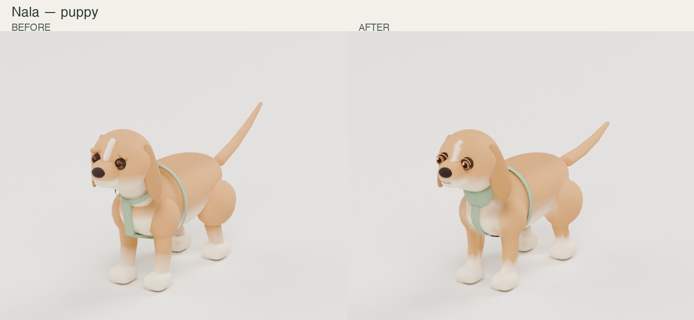
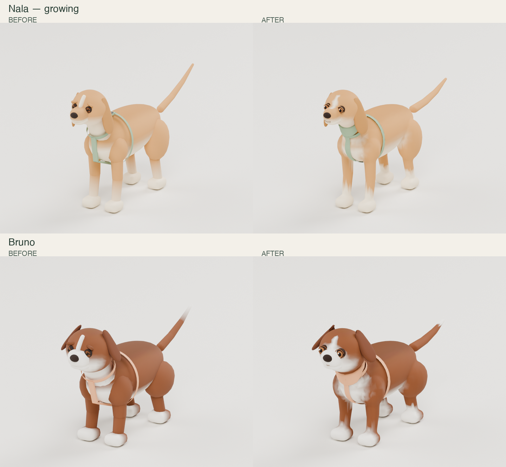
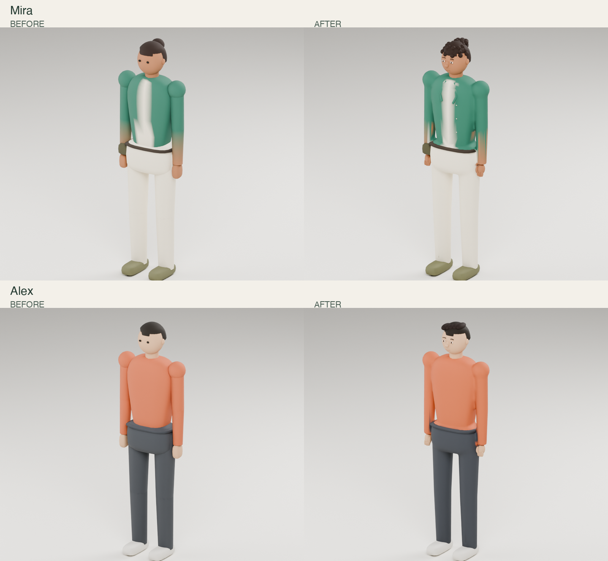

# Blender character refinement — integration handoff for Fable 5.1

Latest character refinement: [HANDOFF_BLENDER_REFERENCE_PASS.md](HANDOFF_BLENDER_REFERENCE_PASS.md) supersedes the first-pass candidates and includes rebuilt humans, refined dogs, turnarounds and current validation evidence. Preserve Fable’s newer rigs when integrating.


Prepared 2026-10-09. Project: `/Users/patabrava/Documents/AI/github/Camilo/Ines`.

## Start here

> Read this handoff, `CLAUDE.md`, `docs/CREATIVE_PLAN.md`, the current decisions log and your own work-package status before integrating. Review the real character sheets and the before/after gallery. Five Blender refinement candidates are under `art/blender-pass-2026-10-09/`; live assets and runtime files were not replaced. Keep your newer 32-bone dog rig and its eye/lid animation work. Transfer useful geometry, colors and facial detail from the editable Blender source onto that rig rather than replacing it with the candidates' older 26-bone rig. Integrate only after reviewing deformation, then run asset checks and the relevant integrated frontend checks. Report only observed results.

## Delivery and ownership

All paths below are relative to the project root. The asset pass owns only `art/blender-pass-2026-10-09/` and this handoff. It supplements WP-G dog geometry/rig work and WP-I supporting-character work. Runtime, camera, UI, environment, pixel profile and lesson work remain with their existing owners. No dependencies were added and no production GLBs or production manifest were overwritten.

- Editable scene: `art/blender-pass-2026-10-09/source/characters_refined.blend`.
- Snapshot used for comparisons: `art/blender-pass-2026-10-09/baseline/`.
- Validated animated GLBs: `art/blender-pass-2026-10-09/candidates/`; its `manifest.json` explicitly says `productionIntegrated: false`.
- Intermediate exports in `candidates/raw/` are **not** the delivery GLBs.
- Measured results: `reports/candidate_metrics.json`, `reports/verification.json`, `reports/eye_region_counts.json` within the pass directory.
- Reproducible authoring, export, packaging, verification and gallery scripts: `scripts/` within the pass directory.

The official Blender MCP stdio server was used for actual Blender authoring and rendering. Most operations used its `execute_blender_code_for_cli` background operation while the GUI was blocked on macOS Documents access. Once the GUI became responsive, the refined scene was opened through the interactive `execute_blender_code` tool and visibly verified in Blender, with Nala framed in material preview. The previous GUI scene was preserved as `source/gui_before_review.blend`; an earlier snapshot is `source/session_before.blend`. Connection details are in `docs/BLENDER_CONNECTION.md`. Codex registration does not automatically register MCP in another client.

## What changed

Nala puppy, Nala growing and Bruno: connected and smoothed body forms, fuller floppy ears, smoothed tail, painted forehead marking, detailed brown irises/pupils/catchlights, thin lid rims and a fitted harness with a chest panel. Vertex colors and the honey/cream, chestnut/white and sage/apricot identities follow the character sheets' written requirements. No fur textures or extra materials were introduced.

Mira and Alex: connected clothing/body forms, recognizable eyes, noses and mouths, brows, finger/thumb forms, Mira's curl clusters/bun and Alex's swept short hair. Their existing forest-green/cream and terracotta/dark clothing identities remain.

These are intermediate stylized refinements, not final reference-sheet fidelity. Human proportions remain close to the procedural baseline. Mira's sleeve and shirt color boundaries still need art cleanup; inspect them in the comparison gallery. The dogs' facial proportions and harness intersections also warrant final art review at gameplay camera distance.

## Measured candidate budgets

| Candidate GLB | Triangles | Bytes | Joints | Character draw calls |
|---|---:|---:|---:|---:|
| dog_nala_puppy.glb | 14,696 | 630,004 | 26 | 1 |
| dog_nala_growing.glb | 14,696 | 629,800 | 26 | 1 |
| dog_bruno_puppy.glb | 14,696 | 630,152 | 26 | 1 |
| human_mira.glb | 15,480 | 521,572 | 20 | 1 |
| human_alex.glb | 13,580 | 460,788 | 20 | 1 |

Every candidate has one primitive/material and at most four skin influences. All five passed the glTF validator with **zero errors and zero warnings**. This pass spends more triangles and bytes than the baseline for better forms; it is not a file-size reduction. Draw-call numbers cover the character alone in an isolated Three.js scene, not the complete game.

## Preserve Fable's rig and animation improvements

The candidates retain the baseline joint names/order, joint rest transforms, inverse bind matrices and every animation input/output array exactly. That preserves 13 dog clips and five human clips from the snapshot. It does not incorporate Fable's subsequent animation or 32-bone eye/lid changes.

The source scene has `BEFORE_<asset>` and `AFTER_<asset>` collections. They overlap spatially for controlled comparisons: display one at a time. Hide bone custom-shape Icospheres; they are import helpers, not shipping geometry. The saved scene opens with only refined Nala visible. Source meshes use Blender axes; packaged candidate GLBs use the original +Y-up coordinate and animation contract. Packaging bakes the exported mesh transform into that original contract.

For dog meshes, `fable_eye_region` is an integer point-domain authoring attribute: 0 body/other, 1 left eye, 2 right eye, 3 upper left lid, 4 upper right lid, 5 lower left lid, 6 lower right lid. Each eye selection has 620 vertices; each lid selection has 78. Check left/right convention against your rig before assigning. These regions are not exported custom skin channels. Current eye/lid geometry is head-weighted and does not independently blink or look around. Reassign it to your eye/lid bones and animate it under D-033.

Body skinning was transferred from nearby baseline vertices, normalized and limited to four influences. A merged mesh can contain separate face/hair/harness components; do not assume the entire asset is a single watertight manifold. Use the mesh as an editable refinement source, not an automatic retopology result.

## Verification actually performed

`verify_candidates.mjs` compared animation arrays, joint contracts and inverse bind matrices against the captured baseline; checked normalized weights and unit normals; loaded each GLB in actual Three.js/GLTFLoader; and rendered every clip at five time fractions. The final browser run completed **245 clip/time samples** with no page errors, finite sampled skin deformation and bounded geometry. It samples every seventh vertex; this is not a complete visual review of every pose.

The browser used installed Chrome with software WebGL. Rest-pose screenshots are in `renders/*_webgl.png`. No phone frame-rate, complete game performance, integrated HUD, frontend suite or backend suite was tested in this isolated asset pass. The project has no game backend to validate here. Existing verification handoff remains the authority for full acceptance.

Before/after PNGs use the same Blender camera, lighting, pose and render settings within each pair. They show actual geometry, not generated concept images. The studio floor and lighting are review aids and excluded from character GLBs.

## Integration sequence

1. Check current work and asset hashes before editing; the baseline predates concurrent Fable work. Do not restore older generator or animation files.
2. Inspect source and galleries, finish face/body/color polish, and transfer accepted geometry to the current rig. Keep original clip names, asset keys, pivots, scale and coordinate contracts.
3. Review all clips for shoulder/hip collapse, paws and soles touching the floor, knee/hand deformation, harness penetration, ears and facial motion. Numerical bounds checks do not prove those qualities.
4. Export selected character geometry and rig only. Retain editable sources. Use glTF Transform cleanup and the existing project validators; measure triangles, materials, influences and byte size after final export.
5. Replace production assets deliberately through the owning work package and update the live manifest/report to the actual integrated result. The candidate manifest is evidence, not a replacement live manifest.
6. Run `npm run assets:check` and the relevant checks in `docs/HANDOFF_VERIFICATION.md`, including integrated renderer and mobile browser views. Measure on a real phone before claiming mobile performance. Preserve all existing gameplay/save/accessibility contracts.

## Reproduction

Run Node scripts from the project root so existing dependencies resolve:

```sh
node art/blender-pass-2026-10-09/scripts/package_candidates.mjs
node art/blender-pass-2026-10-09/scripts/verify_candidates.mjs
```

Packaging uses the saved raw exports and baseline snapshot. Verification serves its own temporary local harness and closes its server/browser afterward. It uses the installed Chrome browser.

`mcp_run.py` uses the installed integration Python and official MCP server. Passing a `.blend` as the second argument selects the background CLI operation. Omitting it targets the visible Blender session. Inspect authoring scripts before rerunning: they save source files and exports. Authoring pipeline order: baseline studio → `refine_characters.py` → `export_candidates.py` → `package_candidates.mjs` → `verify_candidates.mjs`; render comparisons and add authoring eye regions afterward. The final visibility script `show_nala.py` frames the visible GUI scene and saves its layout.

## Gallery






