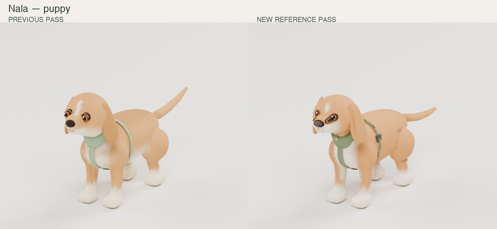
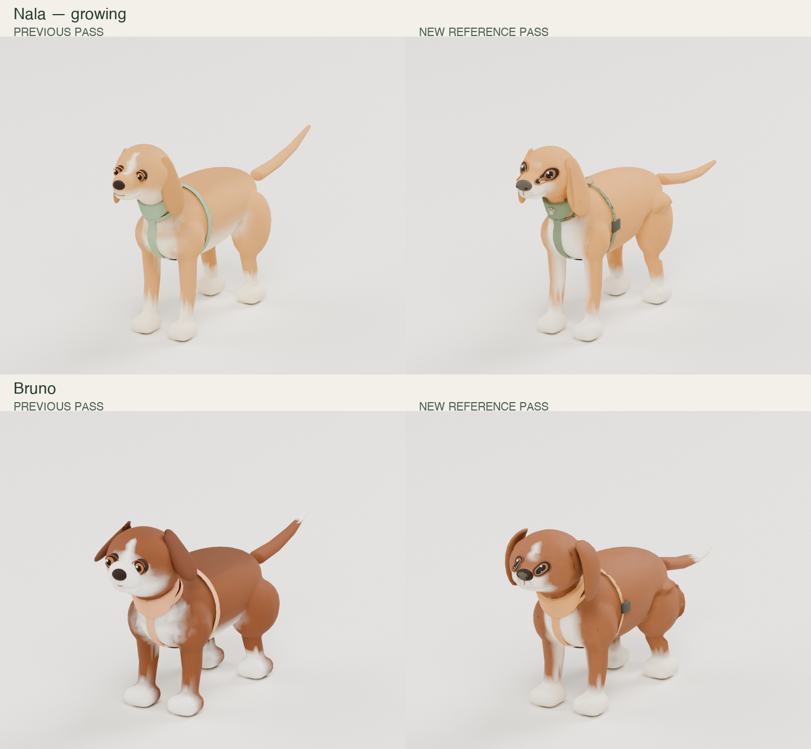
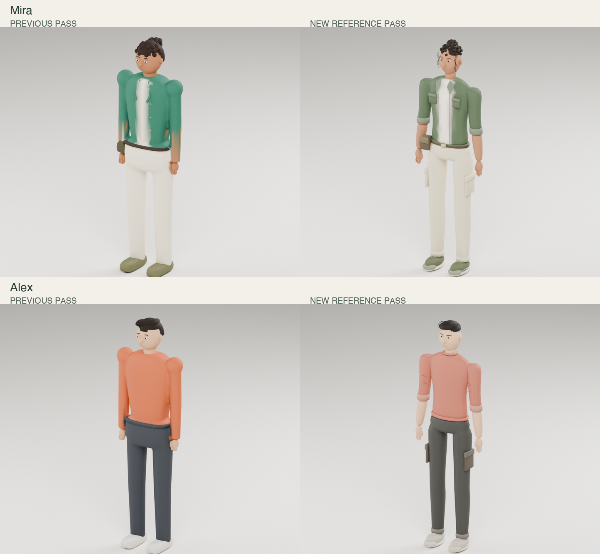
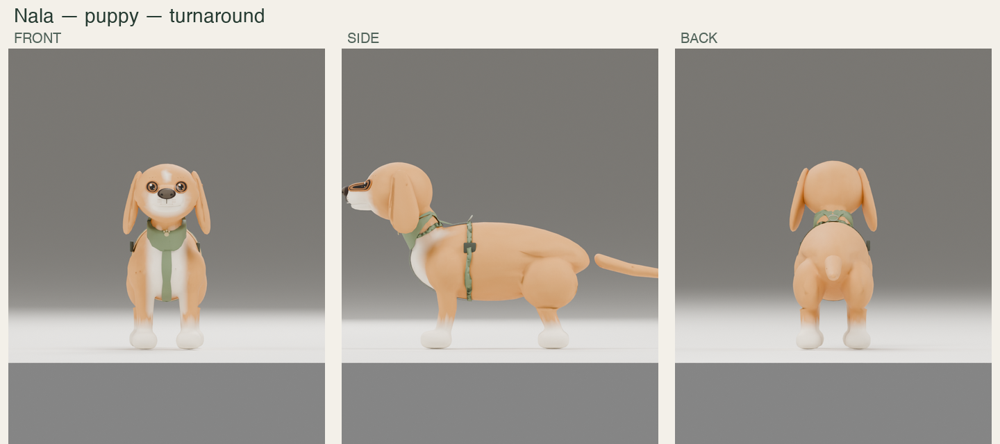
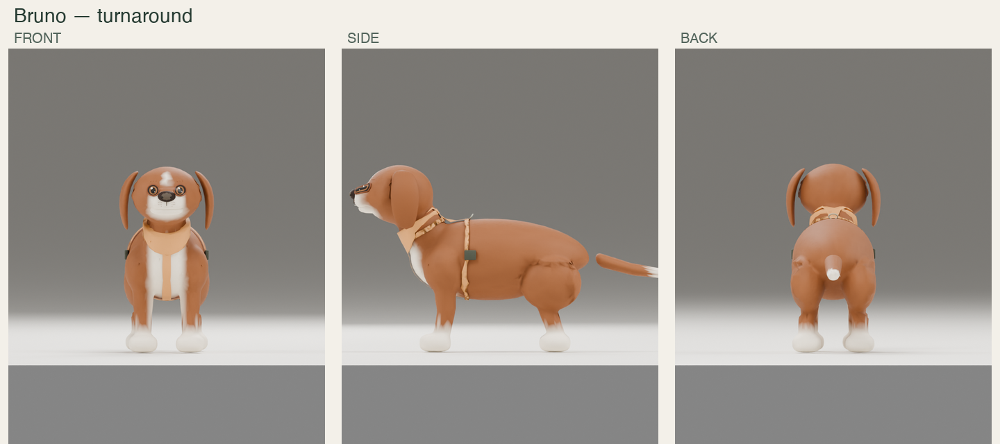
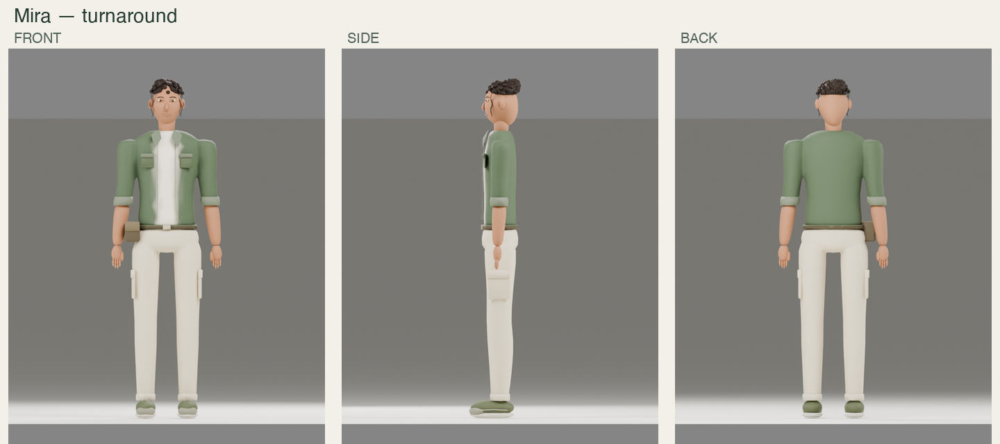
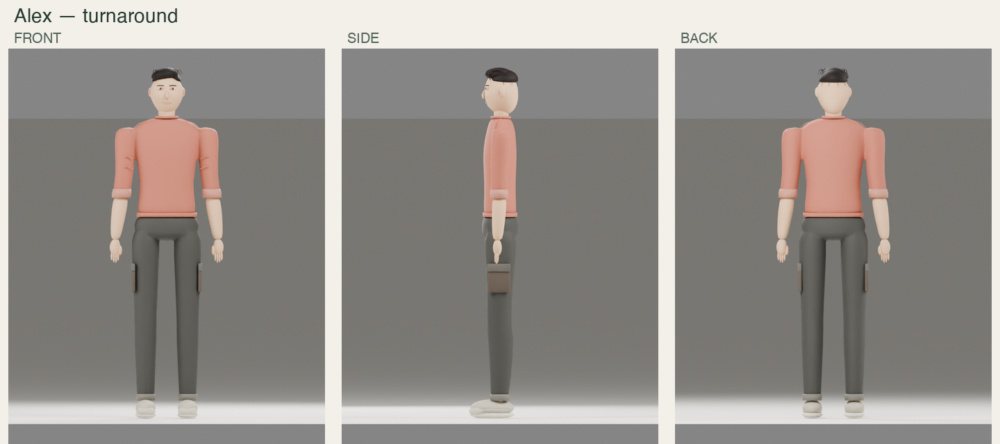

# Reference-led Blender character pass — Fable 5.1

Prepared 2026-10-09. This is the newest asset pass; it supersedes the geometry candidates in `HANDOFF_BLENDER_ASSET_PASS.md`. The earlier pass remains preserved for comparison. Project root: `/Users/patabrava/Documents/AI/github/Camilo/Ines`.

## Execution prompt

> Read this handoff, root `CLAUDE.md`, your current creative plan and decisions before integrating. Open `art/blender-reference-pass-2026-10-09/source/characters_refined.blend`, review the reference sheets and actual Blender/browser renders, and transfer the accepted character surfaces to your current rigs. Keep your newer 32-bone dog rig, eye/lid animation and animation refinements. The delivered GLBs retain an older baseline skeleton and must not overwrite your newer rig work. Preserve the game, live manifest and other work packages; integrate deliberately under their existing ownership. Run the full relevant asset, renderer and mobile acceptance checks after integration. Never report an unseen pass.

## Delivery

The new pass owns `art/blender-reference-pass-2026-10-09/` and this handoff. Runtime, game rules, live GLBs, live manifest, shared generators and ongoing Fable work were not edited by this pass.

- `source/characters_refined.blend`: editable Blender source with before/after collections, embedded normal maps, rigs and retained NLA clips.
- `source/reference_start.blend`: first-pass starting snapshot.
- `candidates/*.glb`: five validated, animated candidates. `candidates/raw/` contains intermediates, not shipping files.
- `candidates/manifest.json`: measured candidate data; `productionIntegrated: false`.
- `textures/*_normal.png`: authored/baked maps. Dog maps are 1024²; human maps are 512². Color stays in vertex attributes.
- `renders/`: matched comparisons, front/side/back turnarounds, portrait close-ups and actual Three.js screenshots.
- `reports/`: validation, surface-map data, source eye selections and runtime verification evidence.
- `scripts/`: reproducible Blender MCP authoring, baking, export, packaging and verification.

The final source was opened in the interactive Blender session through MCP and Nala was framed in material preview. Native GUI inspection could not be reconfirmed at delivery because the Mac was locked; the source-open and save operations succeeded. Asset and render checks completed independently. `reports/delivery_fingerprints.json` identifies the exact delivered files.

These are code-authored Blender refinement candidates, not final production art. The sheets informed silhouette, identity and wardrobe; the meshes remain a simplified interpretation of their more detailed coat, facial and cloth treatment. Rendered comparisons show that actual level of fidelity, without generated replacement pictures.

## Changes from the previous pass

**Nala puppy and growing:** a narrower lower face, shaped muzzle and nostrils, fitted curved eye surfaces with brown irises and catchlights, restrained cream muzzle/bib/paw markings, fine ear strands, limited silhouette feathering, a lower tail, toe seams and harness hardware/paw badge. The growing model preserves the baseline's different head/body proportions rather than simply scaling the puppy.

**Bruno:** chestnut fur, white muzzle/bib/forehead/tail tip, apricot harness and newly lofted soft hanging folded-ear pads. The baseline's raised ear wedges were replaced.

**Mira:** rebuilt torso/sleeves and continuous cargo trousers, an open forest-green shirt jacket over cream, collar/chest pockets/buttons, rolled cuffs, treat pouch, belt, laced olive sneakers, a shaped adult face, slimmer eye apertures, shorter nose, curved brows, softer lips and clustered bun curls with temple tendrils.

**Alex:** rebuilt sweatshirt, rolled cuffs, continuous dark cargo trousers, restrained fabric folds and seams, laced sneakers, a wider jaw/face than Mira, shorter nose, narrower eyes and an asymmetric swept hair mass with fine flow strands.

Human wrists/arms open slightly into a relaxed reference stance. Both characters have palms, finger length variation, thumbs and nail surfaces. Body forms use fitted lofts and selective voxel unions rather than exposed capsule shoulders.

## Final measured candidates

| GLB | Triangles | Bytes | Joints |
|---|---:|---:|---:|
| dog_nala_puppy.glb | 17,680 | 2,032,320 | 26 |
| dog_nala_growing.glb | 17,680 | 2,030,884 | 26 |
| dog_bruno_puppy.glb | 17,680 | 2,034,532 | 26 |
| human_mira.glb | 15,499 | 1,646,428 | 20 |
| human_alex.glb | 15,500 | 1,509,584 | 20 |

Each candidate has one primitive/material, one embedded PNG normal map and at most four skin influences. Materials are double-sided so thin eye, collar and hair surfaces stay visible after export. Existing GLTFLoader supports this; no decoder or package was added. The character alone takes one draw call in the isolated harness.

All five validate with **zero glTF errors and zero warnings**. Two degenerate UV tangent vectors in puppy Nala required a normalized perpendicular fallback; the other four assets required none. The exported tangent frames are checked for unit length, orthogonality to normals and valid handedness.

This pass increases bytes and triangles compared with the first pass to improve forms and surface detail. It is not a performance reduction. PNG normal maps for all five characters would take about 18.7 MiB with RGBA8 decoding and mipmaps; this is an estimate, not a device memory measurement. Load only needed characters and measure on the target phone before promising frame rate.

## Rig integration

The packaged files preserve baseline joint names/order, rest transforms, inverse bind matrices and every animation input/output array exactly: 26 joints and 13 clips per dog, 20 joints and five clips per human. They do not incorporate your subsequent rig or animation improvements.

Transfer geometry and material/UV work onto your current rig. Do not roll back the 32-bone dog or eye/lid work. The dog source meshes include integer point attribute `fable_eye_region`: 0 body/other, 1 left eye, 2 right eye, 3 upper left lid, 4 upper right lid, 5 lower left lid, 6 lower right lid. Counts are in `reports/source_review.json`; check your side convention. Current facial geometry remains head-weighted. Independent blinking/gaze requires reassignment to your newer bones and animations. This authoring selection is not a custom runtime attribute.

Display one `BEFORE_<asset>` or `AFTER_<asset>` collection at a time because they occupy the same space. Importer Icospheres are rig custom-shape helpers, excluded from renders/exports. The studio floor/lights/camera are review aids, excluded from character exports. Selected character mesh and armature are exported; source uses Blender axes and packaging restores the captured +Y-up glTF contract.

## Checks actually performed

`package_candidates.mjs` pruned, deduplicated and welded with glTF Transform, measured the outputs and ran glTF validation/budget checks.

`verify_candidates.mjs` compared the complete skeleton and animation contracts, checked every skin weight, normal, tangent and UV, verified the normal textures, and loaded all five models in actual Three.js. Every vertex was checked for finite skinned positions at five fractions of every clip: **245 clip/time samples** in total. Geometry bounds stayed finite and bounded; the harness reported one character draw call and no page errors.

The browser used installed Chrome with software WebGL. This is stronger numerical coverage than the earlier pass's every-seventh-vertex sampling. It does not prove perfect deformation at every intermediate time, physical floor contact, absence of every mesh intersection or real-phone performance.

The art review used actual Blender full-body pairs, front/side/back views, face close-ups and browser export screenshots. Iteration corrected triangle color artifacts, excessive coat spikes, protruding eye rims, dark diffuse-bake seams, culled thin surfaces, raised Bruno ear wedges, overly long human noses and uniform quiff shapes. The rejected diffuse-color atlas experiment is preserved under `experiments/rejected-albedo/`; none of those images ship.

No full-game frontend/backend suite was rerun as part of this isolated asset change. The project has no game backend. Integrated acceptance remains governed by `docs/HANDOFF_VERIFICATION.md` after Fable installs final assets.

## Reproduction and integration

1. Preserve current uncommitted work and inspect the latest asset/rig state. The captured baseline predates concurrent Fable changes.
2. Review the source and gallery against `docs/pfotenzeit/characters/{01_nala,02_gastwelpen,03_menschen}.png` and the written character bible.
3. Transfer accepted surfaces, UVs and maps to current rigs. Review sit, lie down, walk, eat, ear/tail motion, kneel and reward gestures for penetration and contact. Keep names, units, pivots and asset keys stable.
4. Export and validate again after that transfer. Update production GLBs, manifest and asset report through their owning work package. Do not copy the candidate manifest over the live manifest.
5. Run `npm run assets:check` and the integrated renderer/mobile checks from the verification handoff. Measure real-phone performance and visibility within the actual German HUD.

Run Node commands from the project root with existing dependencies:

```sh
node art/blender-reference-pass-2026-10-09/scripts/package_candidates.mjs
node art/blender-reference-pass-2026-10-09/scripts/verify_candidates.mjs
```

Blender operations use the official MCP bridge, through `scripts/mcp_run.py` and the installed integration Python documented in `docs/BLENDER_CONNECTION.md`. With a `.blend` second argument, the runner calls the official background CLI tool; without it, the runner targets visible Blender. Authoring order: `author_reference.py` from `source/reference_start.blend` → `bake_surface.py` → `export_candidates.py` → Node packaging and verification. Review renders and `source_report.py` follow. `open_review.py` preserves the current GUI scene as a timestamped snapshot before opening the delivery; `show_nala.py` frames Nala and saves the review layout.

## Gallery

These comparisons use the previous delivered Blender pass on the left and the new pass on the right. Individual `*_before.png` files separately preserve the original procedural baseline comparison.














